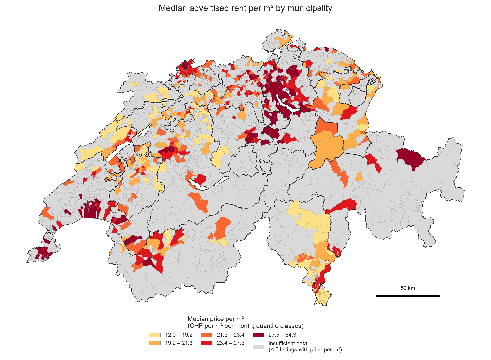

# swiss-rent-drivers

**What drives residential rents in Switzerland?** A data pipeline and analysis that scrapes rental apartment listings (Selenium), combines them with open data on railway stations, municipality boundaries and taxable income, and studies what is associated with rents: the dwelling itself, the distance to a railway station, and the municipality it lies in (with choropleth maps).



## Main findings

Based on 14,065 cleaned rental apartment listings (Flatfox snapshot, November 2026). All results are associations in asking rents, not causal effects.

- **Dwelling characteristics (RQ1):** the living area (Spearman ρ = 0.625) and the number of rooms (ρ = 0.517) are most strongly associated with the gross rent; lift, balcony/garden and parking are much weaker (ρ = 0.16 to 0.24). A linear regression reaches an MAE of 486 CHF (R² = 0.45) against 544 CHF for a median-per-rooms baseline.
- **Railway station distance (RQ2):** weak association with the price per m² (ρ = −0.061). Median 23.55 CHF/m² within 0.5 km of a station, 22.00 CHF/m² beyond 2 km.
- **Municipality context (RQ3):** the municipal median price per m² correlates with the mean taxable income (ρ = 0.511, n = 485) and with population density (ρ = 0.462, n = 490). Prices are highest around Zürich, Basel and Lake Geneva.

The full write-up is in [`report/report.md`](report/report.md); figures and captions are in [`figures/`](figures/), result tables in [`tables/`](tables/).

## Pipeline

1. **Open data** (`01_external_data.py`): railway stations, municipality polygons with population, mean taxable income.
2. **Scraping** (`02_collect_listings.py`): headless Chrome via Selenium interacts with the search field, the filter dropdown and the "Show more" button, and tiles the map of Switzerland (a view shows at most 400 listings, so a box with 400 or more listings is split into four). The listing data are read from the JSON that the search page itself loads in the same browser session.
3. **Parsing** (`03_parse_listings.py`): maps the JSON to a flat table and cross-checks it against saved listing pages with BeautifulSoup.
4. **Cleaning** (`04_clean.py`): six logged steps (missing data, data types, value ranges, outliers, format, enrichment).
5. **Integration** (`05_integrate.py`): spatial join to municipalities, nearest railway station (BallTree, haversine), income merge, municipality summary.
6. **Analysis** (`06_rq1.py`, `07_rq2.py`, `08_rq3_maps.py`): tables, figures and maps.
7. **Report** (`09_build_report.py`): builds the PDF report from `report/report.md`.

## How to run

Requirements: Python 3.11, Google Chrome (Selenium 4 downloads the matching chromedriver itself), about 1 GB free disk space. Run everything from the repository root.

```bash
python -m venv .venv
.venv/Scripts/activate        # Windows; on macOS/Linux: source .venv/bin/activate
pip install -r requirements.txt
```

Each script is idempotent and skips work that is already done.

| Step | Command | What it does | Expected run time |
|---|---|---|---|
| 1 | `python src/01_external_data.py` | downloads stations, municipalities, income; writes `data/processed/` | 1 to 2 min (65 MB download) |
| 2 | `python src/02_collect_listings.py --test` | test run for the Lucerne box (about 280 listings) | about 1 min |
| 2 | `python src/02_collect_listings.py` | UI demonstration, map tiling for all of Switzerland, collects listings (resumable) | about 40 min |
| 3 | `python src/03_parse_listings.py` | JSON to `data/interim/listings_parsed.csv`, cross-check | under 1 min |
| 4 | `python src/04_clean.py` | cleaning, `listings_clean.parquet`, `tables/missing_values.csv`, `tables/cleaning_log.csv` | under 10 s |
| 5 | `python src/05_integrate.py` | municipality, station distance, income, municipality summary | about 10 s |
| 6 | `python src/06_rq1.py` | RQ1 tables and figures | about 10 s |
| 7 | `python src/07_rq2.py` | RQ2 table and figure | about 5 s |
| 8 | `python src/08_rq3_maps.py` | RQ3 table, scatter plot, municipality maps | about 15 s |
| 9 | `python src/09_build_report.py` | PDF report from `report/report.md` (needs Chrome) | about 10 s |

The raw data (`data/raw/`, `data/interim/`) is created by the scripts and is not part of the repository; `data/processed/municipality_summary.csv` is the only committed data file (aggregated to municipality level).

## Data sources

| # | Source | Used for | Link |
|---|---|---|---|
| 1 | Flatfox rental listings (web scraping with Selenium) | main dataset | https://flatfox.ch/en/search/ |
| 2 | atlas service points, SBB / opentransportdata.swiss (`actual-date-swiss-service-point.csv`) | nearest railway station (RQ2) | https://data.opentransportdata.swiss/dataset/service-point-v2 |
| 3 | swissBOUNDARIES3D, swisstopo (release 2026-01, GeoPackage) | municipality of each listing, population, density, maps | https://www.swisstopo.admin.ch/en/landscape-model-swissboundaries3d |
| 4 | ESTV direct federal tax statistics by municipality, tax year 2022 (`statistik-dbst-np-gden-2022-normalfall.xlsx`) | mean taxable income (RQ3) | https://www.estv.admin.ch/de/statistiken-natuerliche-personen-gemeinden-1983-bis-heute |

Sources 2 to 4 are open government data (opendata.swiss terms: open use, the source must be cited). The Flatfox data are used only for this non-commercial project and are not redistributed.

## Legal and ethical note

- `robots.txt` of flatfox.ch allows crawling (`Allow: /`); the disallowed paths (`/admin/`, `/cockpit/`, `/partner/`, `/temp/`, `/lang/`) are never requested. A dated copy is in [`docs/robots_flatfox.txt`](docs/robots_flatfox.txt).
- The Flatfox terms (GTC section 4.2) restrict the re-use of listings: the data are used only for this non-commercial project and are not published. `data/raw/` and `data/interim/` are git-ignored.
- Politeness: at most 1 request per second to flatfox.ch, a generic User-Agent (`CIP-HS26-student-project`, no e-mail address), cookies are rejected in the cookie banner, no login, no CAPTCHA solving, no proxies. The run stops on HTTP 403 or 429.
- No personal data are stored: no names of real-estate agents or contact persons, phone numbers, e-mail addresses or free-text descriptions.

## Data collection note

Plain `requests` calls to listing pages are answered with HTTP 403 and loading every page through Selenium would take about 19 hours, while the HTML contains no coordinates. The listing data are therefore taken from the JSON that the Flatfox search page itself loads in the Selenium session (read from the Chrome network log; only whitelisted fields are stored). Details of the site structure, the selectors and the decision are in [`docs/data_collection_notes.md`](docs/data_collection_notes.md); the UI interaction is logged in [`docs/selenium_interaction.log`](docs/selenium_interaction.log).

A cross-check of 10 saved listing pages shows that rents, rooms and areas in the JSON differ from the detail pages for many listings (`tables/parse_crosscheck.csv`). Which version is the true advertised rent cannot be decided from outside; the analysis uses the JSON values (the numbers shown on the search cards). This is discussed as a limitation in the report.

## Team

Developed as a course project in the HSLU MSc Applied Information and Data Science (module Data Collection, Integration and Preprocessing, HS26) by **Ibtihel Frini**, **Yasna Ahmad** and **Erenalp Çakiroğlu**. The research questions and data sources come from the joint feasibility study ([`docs/`](docs/)).


## Repository layout

```
swiss-rent-drivers/
  README.md
  requirements.txt
  docs/                    feasibility study, robots.txt copy, data collection notes, Selenium interaction log
  src/                     config.py, utils.py, 01_external_data.py ... 09_build_report.py
  data/
    raw/        (ignored)  external downloads, test pages
    interim/    (ignored)  collected listings (JSON subset), parsed listings, tile log
    processed/             parquet/gpkg files (ignored); municipality_summary.csv is committed
  figures/                 PNG (300 dpi) and captions.md
  tables/                  result tables, missing_values.csv, cleaning_log.csv, parse_crosscheck.csv
  report/                  report.md (the PDF is built with src/09_build_report.py)
```
