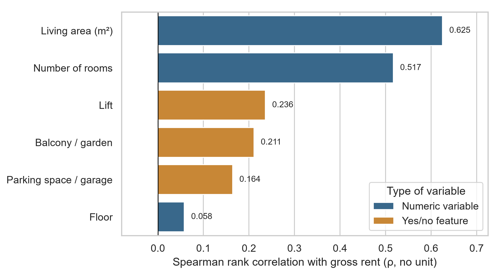
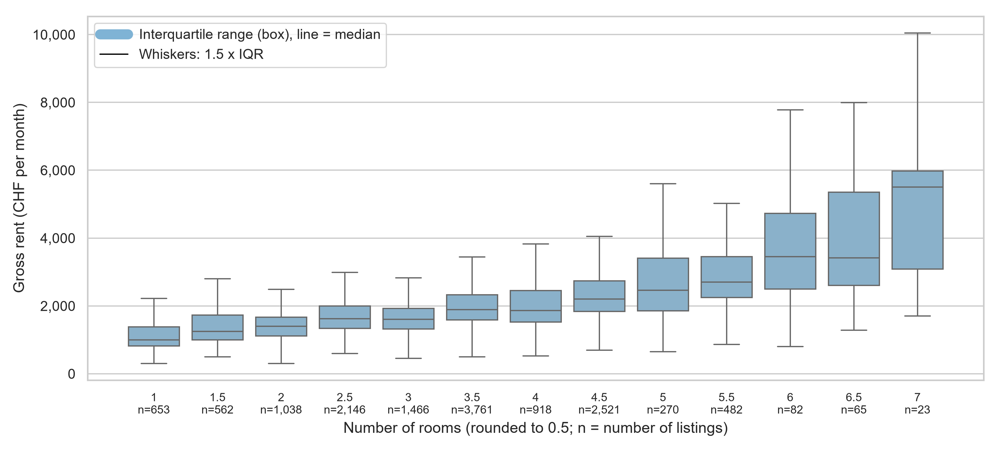
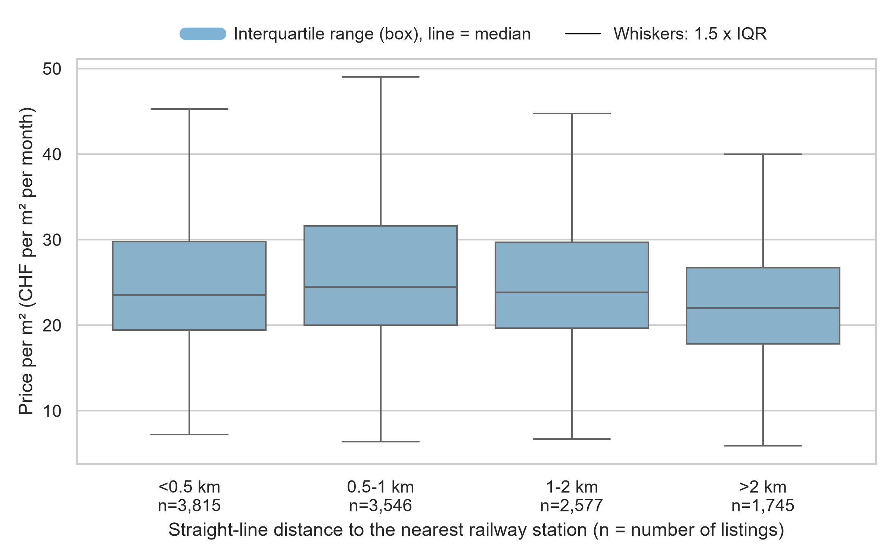
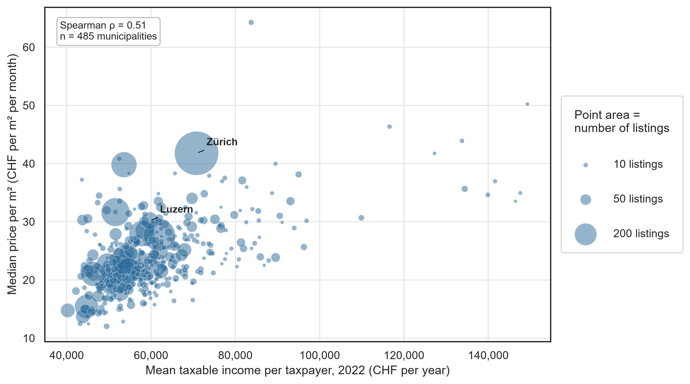
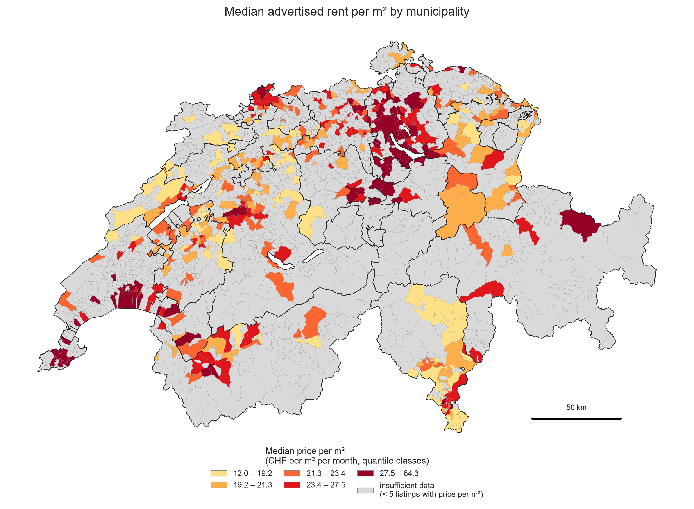
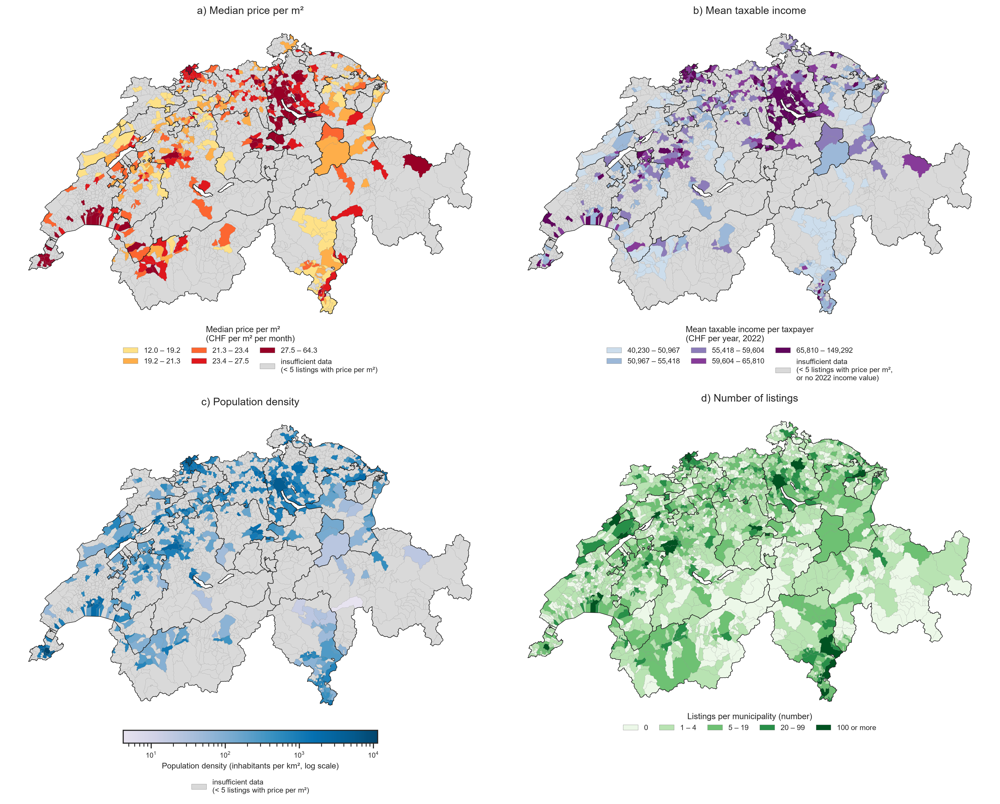

# What drives residential rents in Switzerland?

Ibtihel Frini, Yasna Ahmad, Erenalp Çakiroğlu · HSLU MSc Applied Information and Data Science, module CIP (Data Collection, Integration and Preprocessing), HS26 · November 2026

## 1 Introduction and motivation

Housing is a major expense for Swiss households, and advertised rents differ strongly between dwellings and between places. This project asks one question: **what drives residential rents in Switzerland?** Three sub-questions look at it from three levels, from the dwelling to its micro-location to the municipality it lies in. **RQ1:** which property characteristics are most strongly associated with the rent? **RQ2:** how is the accessibility of public transport, measured as the distance to the nearest railway station, associated with the price per m²? **RQ3:** how are demographic and economic characteristics of a municipality (population density, mean taxable income) associated with prices, and how do prices vary across Swiss municipalities?

We use a snapshot of rental apartment listings of the platform Flatfox (November 2026) and combine it with three open datasets. "Price" is the advertised monthly gross rent in CHF (net rent plus charges); `price_m2` is the gross rent divided by the living area (CHF per m² per month). All results are associations in asking rents, not causal effects.

## 2 Methods

### 2.1 Data sources

| Source | Type | Content | Used for |
|---|---|---|---|
| Flatfox rental listings | web scraping, Selenium | rent, rooms, area, floor, features, address, coordinates | all RQs |
| atlas service points (SBB, opentransportdata.swiss) | CSV download | 1,743 railway stations with coordinates (of 60,460 service points) | RQ2 |
| swissBOUNDARIES3D 2026 (swisstopo) | GeoPackage download | 2,110 municipality polygons, population, area | municipality join, density, maps |
| ESTV direct federal tax statistics 2022 | Excel download | taxable income and taxpayers per municipality (2,148 rows) | RQ3 |

The three open sources are cited as required by the opendata.swiss terms.

### 2.2 Data acquisition

A Flatfox search view shows at most 400 listings. `02_collect_listings.py` therefore drives a headless Chrome session through the page like a visitor (rejecting the optional cookies, typing a place into the search field, opening the filter dropdown and choosing "For rent" and "Apartment", clicking "Show more"; logged in `docs/selenium_interaction.log`) and then tiles the map of Switzerland: a map box that reaches the 400-listing notice is split into four boxes, and in each final box "Show more" is clicked until the list stops growing (at least one second between actions). The run used 429 tiles (107 splits, none left at the cap) and found **17,173 unique listings** (`tables/cleaning_log.csv`, step `clean_0_input`; tile counts from `data/interim/tiles_done.csv`).

Plain `requests` calls to listing pages are answered with HTTP 403, and downloading all pages through Selenium would take about 19 hours. The listing data are therefore taken from the JSON that the search page itself loads in the same Selenium session (Chrome network log, no additional requests). This JSON also contains exact coordinates, which the listing HTML does not. Only whitelisted fields are stored. BeautifulSoup parses saved listing pages to cross-check the JSON (section 4). Reconnaissance notes are in `docs/data_collection_notes.md`.

### 2.3 Legal and ethical aspects

The `robots.txt` of flatfox.ch allows the pages used (a dated copy is in `docs/`); the disallowed paths are never requested. The Flatfox terms (GTC 4.2) restrict the re-use of listings, so the data are used only for this non-commercial course project and are not published (raw and interim data are git-ignored; only municipality-level aggregates are committed). The collection waits at least one second between actions, uses a generic User-Agent without contact data, does not log in, and stops on HTTP 403 or 429. No personal data (names, phone numbers, e-mail addresses, description texts) are stored.

### 2.4 Cleaning

The six mandatory steps are implemented in `04_clean.py` and logged with rows before and after (`tables/cleaning_log.csv`). Out of 17,173 listings, 14,065 remain.

| Step | Action | Effect |
|---|---|---|
| 1 Missing data | share missing per column (`tables/missing_values.csv`: area 17.5 %, floor 29.8 %, year built 68.8 %, so year built is not used in models); 0 treated as missing (117 gross rents, 19 net rents, 37 areas); gross rent = net rent + charges where missing (1,815 listings); rows without gross rent dropped | −328 rows; 2,959 rows without area kept (`has_area = False`) |
| 2 Data types | numeric prices, area and rooms; integer floor (ground floor 0); string ZIP; booleans; features to 0/1 columns (balcony/garden, lift, parking/garage, Minergie) | no rows removed |
| 5 Format | only regular apartment types (furnished flats −744, single rooms −564, attic −3); furnished or temporary listings removed (−1,222; 1,058 furnished and 818 temporary, some both); duplicate flats (same street, ZIP, rooms, area, rent) −162 | −2,695 rows |
| 6 Enrichment | `price_m2` = gross rent / area | 11,753 listings with area |
| 3 Value ranges | gross rent 300 to 15,000 CHF (−40), area 15 to 400 m² (−26), rooms 1 to 10 (−2), `price_m2` 5 to 100 (−17); 5 implausible floors set to missing | −85 rows |
| 4 Outliers | `price_m2` outside 1.5 × IQR flagged, not deleted (the final flag is set per canton during the integration: 449 listings) | flag only |

Steps 5 and 6 run before step 3 so that the ranges apply to the target population and to `price_m2`.

### 2.5 Integration and analysis

Each listing is assigned to a municipality by a spatial join in EPSG:2056 (all 14,065 listings matched; the geocoding fallback via geo.admin.ch was not needed), to its nearest railway station by a haversine BallTree (straight-line distance, bands <0.5, 0.5 to 1, 1 to 2 and >2 km), and to the mean taxable income of its municipality (ESTV 2022 vs 2026 boundaries: 13,961 listings matched, 104 lie in municipalities merged after 2022). The municipality summary has 1,451 municipalities with listings; **490 have at least five listings with a known area** and are used for RQ3.

RQ1 uses Spearman correlations, median rents by number of rooms and one linear regression of the gross rent on area, rooms, floor, balcony/garden, lift and parking (rows with all values and without outliers, 80/20 split, MAE and R² on the test set, baseline: median rent per number of rooms from the training set). RQ2 uses median `price_m2` per distance band and Spearman correlations. RQ3 uses Spearman correlations of municipality medians with density and income and choropleth maps (GeoPandas).

## 3 Results and discussion

### 3.1 RQ1: property characteristics

<figure style="flex:4"><figcaption><b>Figure 1.</b> Spearman correlation of the gross rent (CHF per month) with six characteristics (n = 9,964 to 14,065; <code>tables/rq1_spearman.csv</code>).</figcaption></figure>
<figure style="flex:6"><figcaption><b>Figure 2.</b> Gross rent (CHF per month) by number of rooms; n per group below the labels (<code>tables/rq1_rent_by_rooms.csv</code>).</figcaption></figure>

Size dominates (Figure 1): the living area has the strongest rank correlation with the rent (ρ = 0.625, n = 11,683), followed by the number of rooms (ρ = 0.517, n = 14,016). The amenities are much weaker: lift 0.236, balcony/garden 0.211, parking 0.164, and the floor is almost unrelated (0.058). The median rent rises from 1,000 CHF for one room to 1,618 CHF for 2.5 rooms, 2,200 CHF for 4.5 rooms and 5,500 CHF for seven rooms, with a growing spread (Figure 2).

The linear regression (6,593 training and 1,649 test listings) reaches an MAE of 486 CHF and an R² of 0.45 on the test set; the baseline (median per number of rooms) reaches 544 CHF and 0.20. Each additional m² is associated with +19.6 CHF, a lift with +171 CHF and each floor with +45 CHF; the coefficient of the rooms is slightly negative (−22 CHF) because rooms and area are strongly collinear. The model explains less than half of the variation: what a flat costs depends largely on where it is, which RQ2 and RQ3 examine (`tables/rq1_model.csv`).

### 3.2 RQ2: public-transport accessibility

<figure class="mid"><figcaption><b>Figure 3.</b> Price per m² (CHF per m² per month) by straight-line distance to the nearest railway station (n = 11,683; <code>tables/rq2_bands.csv</code>).</figcaption></figure>

The association is weak (Figure 3). Listings within 0.5 km of a station have a median of 23.55 CHF/m², those at 0.5 to 1 km 24.43 CHF/m² (the highest), at 1 to 2 km 23.83 CHF/m², and those farther than 2 km 22.00 CHF/m² (n = 3,815, 3,546, 2,577 and 1,745). The Spearman correlation between the distance and the price per m² is ρ = −0.061 for all listings (n = 11,683) and −0.056 for the 10,525 listings with a street address and their own coordinates (`tables/rq2_spearman.csv`). Prices tend to be slightly lower far from a station, but station distance explains almost none of the variation; the p-values are small only because n is large. Distance is partly confounded with centrality: central, dense locations are expensive and close to a station, while the cheapest rural areas are far from one, so a pooled correlation can hide opposite effects.

### 3.3 RQ3: municipality characteristics and spatial pattern

The median price per m² of municipalities is moderately and positively correlated with the mean taxable income (ρ = 0.51, n = 485) and with the population density (ρ = 0.46, n = 490; `tables/rq3_spearman.csv`). Figure 4 shows the pattern: the large cities lie on the upward trend (Zürich: 41.76 CHF/m², income 70,786 CHF, 759 listings; Basel 27.68; Lausanne 31.65; Lugano 23.54; St. Gallen 21.58; `data/processed/municipality_summary.csv`), while the few small municipalities with very high incomes (above about 115,000 CHF) have only a handful of listings each.

<figure class="mid"><figcaption><b>Figure 4.</b> Mean taxable income 2022 (CHF per year) against the median price per m² (CHF per m² per month) for 485 municipalities; point area = number of listings.</figcaption></figure>

<figure class="wide"><figcaption><b>Figure 5.</b> Median advertised rent per m² (CHF per m² per month) by municipality, quantile classes; thin lines: municipality borders, dark lines: canton borders; light grey: insufficient data (fewer than five listings with a known area, 1,620 of 2,110 municipalities). Municipalities on Lake Geneva include their share of the lake in the official data.</figcaption></figure>

The map (Figure 5) shows the spatial pattern: the highest classes (27.5 to 64.3 CHF/m²) cluster in the Zürich agglomeration and around the lake, around Basel, along Lake Geneva and in some Valais and Ticino municipalities, whereas the lowest classes appear in the Jura, the Mittelland and parts of Ticino. The panel in Figure 6 shows that the income and density maps follow a similar pattern (the Zürich agglomeration, Basel, the Lake Geneva arc), and that the listings are concentrated in the cities. The maps also show where Flatfox has enough listings: most Alpine and rural municipalities are grey, so the correlations describe towns and agglomerations rather than all of Switzerland.

<figure class="wide"><figcaption><b>Figure 6.</b> Municipality characteristics used for RQ3: a) median price per m² (CHF per m² per month), b) mean taxable income per taxpayer (CHF per year, 2022), c) population density (inhabitants per km², logarithmic colour scale), d) number of listings. Panels a to c show only the 490 municipalities with at least five listings with a known area (light grey: insufficient data); dark lines are canton borders.</figcaption></figure>

## 4 Conclusion

**Answer.** Rents are driven first by the size of the dwelling (area, rooms), second by where the dwelling is in terms of the municipality (income and density context), and much less by the amenities of the flat or the straight-line distance to a railway station. A regression on dwelling characteristics alone explains less than half of the rent variation (R² = 0.45), which supports the role of location.

**Learnings.** A dynamic site needs interaction and tiling because of the 400-listing cap; a plain HTTP client was refused, so the approach had to change to reading the JSON that the page loads in a normal browser session, which also delivered exact coordinates. Merging sources with different geographic keys (2022 income vs 2026 boundaries) needs explicit logging of the mismatches. Every cleaning decision (zero placeholders, duplicates, ranges) changes the sample and is therefore logged.

**Limitations.** (1) Asking rents are not contract rents. (2) One snapshot (November 2026) and one platform; Flatfox is not a random sample of all rentals and is concentrated in towns. (3) The JSON values differ from the detail pages for many listings: in a check of 10 saved pages, 56 of 76 comparable field pairs are identical (floor, year built and features always), but gross rent differs in 7 of 9 pairs, living area in 5 of 7 and rooms in 3 of 10, with the detail page showing the higher rent in every differing pair (`tables/parse_crosscheck.csv`); we cannot decide which version is the true advertised rent and used the JSON (the values shown on the search cards). (4) 17.5 % of the listings have no area, so the price per m² is available for 11,683 of 14,065 listings, and 30 % have no floor. (5) ESTV income is from 2022 and the boundaries from 2026, so 12 municipalities merged since then have no income value. (6) The public-transport quality classes of the ARE are not used and the distance is straight-line, to railway stations only. (7) All results are correlations; density, income and centrality are related to each other.

**Outlook.** Repeated scrapes would allow changes over time and a comparison of asking and contract rents; a hedonic model with municipality or distance-to-centre effects, travel times to stations and the ARE quality classes would separate the location components better; a second listing platform would test how representative the data are.

**Sources.** Flatfox (flatfox.ch, accessed 3 November 2026); SBB, atlas service points, opentransportdata.swiss; swisstopo, swissBOUNDARIES3D (release 2026-01); Federal Tax Administration ESTV, direct federal tax statistics by municipality, tax year 2022. Code and data preparation: repository `swiss-rent-drivers`.
